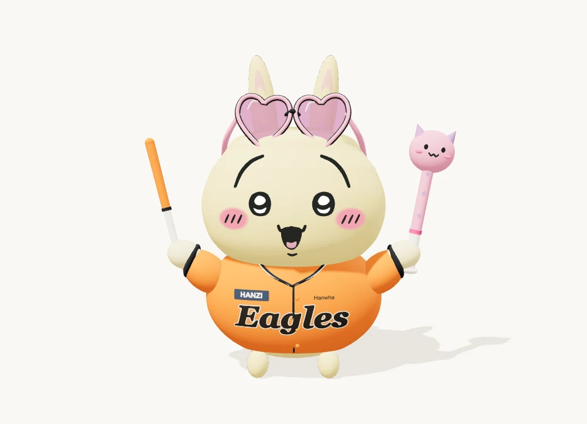

# Hanzi-Cho

## Character Studio

React · TypeScript · Three.js · Procedural 3D

[3D로 돌려보기 ↗](https://hanzi-cho.github.io/character-studio/profile.html) · [캐릭터 편집 데모](https://hanzi-cho.github.io/character-studio/) · [소스](https://github.com/Hanzi-Cho/character-studio)

